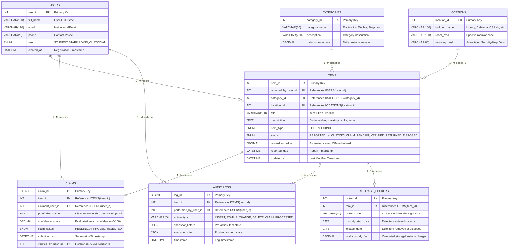
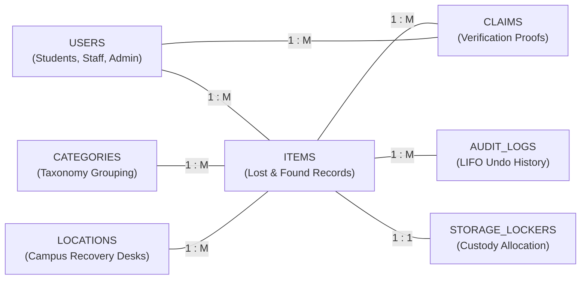

# 🏛️ Entity-Relationship (ER) Diagram: Lost and Found Management System

This document outlines the **Entity-Relationship (ER) Model** and **Relational Database Schema** designed for the **Lost and Found Management System** (MySQL / ADBMS).

---

## 1. 🗄️ Detailed Relational ER Diagram (Schema & Attributes View)

---

## 2. 🧩 Primary Relationships Diagram (High-Level Conceptual View)

---

## 3. 📋 Table-by-Table Data Dictionary

### Table: `USERS`
| Column Name | Data Type | Constraint | Description |
| :--- | :--- | :--- | :--- |
| `user_id` | `INT` | `PK, AUTO_INCREMENT` | Unique identifier for each user |
| `full_name` | `VARCHAR(100)` | `NOT NULL` | Full name of the user |
| `email` | `VARCHAR(120)` | `NOT NULL, UNIQUE` | University / official email address |
| `phone` | `VARCHAR(20)` | `NOT NULL` | Contact telephone number |
| `role` | `ENUM` | `DEFAULT 'STUDENT'` | `'STUDENT'`, `'STAFF'`, `'ADMIN'`, `'CUSTODIAN'` |
| `created_at` | `DATETIME` | `DEFAULT CURRENT_TIMESTAMP` | Account registration date/time |

### Table: `CATEGORIES`
| Column Name | Data Type | Constraint | Description |
| :--- | :--- | :--- | :--- |
| `category_id` | `INT` | `PK, AUTO_INCREMENT` | Unique category code |
| `category_name` | `VARCHAR(60)` | `NOT NULL, UNIQUE` | E.g., `Electronics`, `Documents`, `Keys/Wallets` |
| `description` | `VARCHAR(200)` | `NULL` | Guidelines and item classification details |
| `daily_storage_rate` | `DECIMAL(6,2)` | `DEFAULT 2.00` | Custody fee rate per day for items in this category |

### Table: `LOCATIONS`
| Column Name | Data Type | Constraint | Description |
| :--- | :--- | :--- | :--- |
| `location_id` | `INT` | `PK, AUTO_INCREMENT` | Unique location code |
| `building_name` | `VARCHAR(100)` | `NOT NULL` | Building/Facility (Library, Sports Complex, Block A) |
| `room_area` | `VARCHAR(100)` | `NOT NULL` | Specific area (2nd Floor Reading Room, Lab 304) |
| `recovery_desk` | `VARCHAR(80)` | `NOT NULL` | Nearest lost & found custody point |

### Table: `ITEMS`
| Column Name | Data Type | Constraint | Description |
| :--- | :--- | :--- | :--- |
| `item_id` | `INT` | `PK, AUTO_INCREMENT` | Unique identifier for the lost/found item |
| `reported_by_user_id`| `INT` | `FK -> USERS(user_id)` | User who reported the item |
| `category_id` | `INT` | `FK -> CATEGORIES(category_id)`| Category taxonomy classification |
| `location_id` | `INT` | `FK -> LOCATIONS(location_id)` | Location where item was lost or found |
| `title` | `VARCHAR(150)` | `NOT NULL` | Short descriptive title of item |
| `description` | `TEXT` | `NOT NULL` | Full details, markings, serial numbers, color |
| `item_type` | `ENUM` | `NOT NULL` | `'LOST'` or `'FOUND'` |
| `status` | `ENUM` | `DEFAULT 'REPORTED'` | `'REPORTED'`, `'IN_CUSTODY'`, `'CLAIM_PENDING'`, `'VERIFIED_RETURNED'`, `'DISPOSED'` |
| `reward_or_value` | `DECIMAL(10,2)`| `DEFAULT 0.00` | Estimated value or owner reward |
| `reported_date` | `DATETIME` | `DEFAULT CURRENT_TIMESTAMP` | Date and time when the report was lodged |
| `updated_at` | `DATETIME` | `ON UPDATE CURRENT_TIMESTAMP`| Last status/detail update time |

### Table: `CLAIMS`
| Column Name | Data Type | Constraint | Description |
| :--- | :--- | :--- | :--- |
| `claim_id` | `BIGINT` | `PK, AUTO_INCREMENT` | Unique claim verification ticket ID |
| `item_id` | `INT` | `FK -> ITEMS(item_id)` | The found item being claimed |
| `claimant_user_id` | `INT` | `FK -> USERS(user_id)` | User claiming ownership |
| `proof_description` | `TEXT` | `NOT NULL` | Identifying marks, receipts, passcode proofs |
| `confidence_score` | `DECIMAL(5,2)` | `DEFAULT 0.00` | Computed match percentage (0% to 100%) |
| `claim_status` | `ENUM` | `DEFAULT 'PENDING'` | `'PENDING'`, `'APPROVED'`, `'REJECTED'` |
| `submitted_at` | `DATETIME` | `DEFAULT CURRENT_TIMESTAMP` | Timestamp when claim was submitted (Queue order) |
| `verified_by_user_id`| `INT` | `FK -> USERS(user_id)` | Admin/Custodian who verified the claim |

### Table: `AUDIT_LOGS`
| Column Name | Data Type | Constraint | Description |
| :--- | :--- | :--- | :--- |
| `log_id` | `BIGINT` | `PK, AUTO_INCREMENT` | Unique log entry ID |
| `item_id` | `INT` | `FK -> ITEMS(item_id)` | Item affected by this action |
| `performed_by_user_id`| `INT` | `FK -> USERS(user_id)` | Admin/User who initiated the action |
| `action_type` | `VARCHAR(50)` | `NOT NULL` | `'INSERT'`, `'STATUS_CHANGE'`, `'DELETE'`, etc. |
| `snapshot_before` | `JSON` | `NULL` | Prior record state (used for LIFO Undo) |
| `snapshot_after` | `JSON` | `NULL` | New record state |
| `timestamp` | `DATETIME` | `DEFAULT CURRENT_TIMESTAMP` | Action execution timestamp |

### Table: `STORAGE_LOCKERS`
| Column Name | Data Type | Constraint | Description |
| :--- | :--- | :--- | :--- |
| `locker_id` | `INT` | `PK, AUTO_INCREMENT` | Unique storage locker record ID |
| `item_id` | `INT` | `FK -> ITEMS(item_id)` | Found item placed in custody |
| `locker_code` | `VARCHAR(20)` | `NOT NULL` | Physical locker box ID (e.g., `L-101`) |
| `custody_start_date`| `DATE` | `NOT NULL` | Date when item was locked in custody |
| `release_date` | `DATE` | `NULL` | Date item was handed over or disposed |
| `total_custody_fee` | `DECIMAL(8,2)` | `DEFAULT 0.00` | Custody/storage handling fee |
